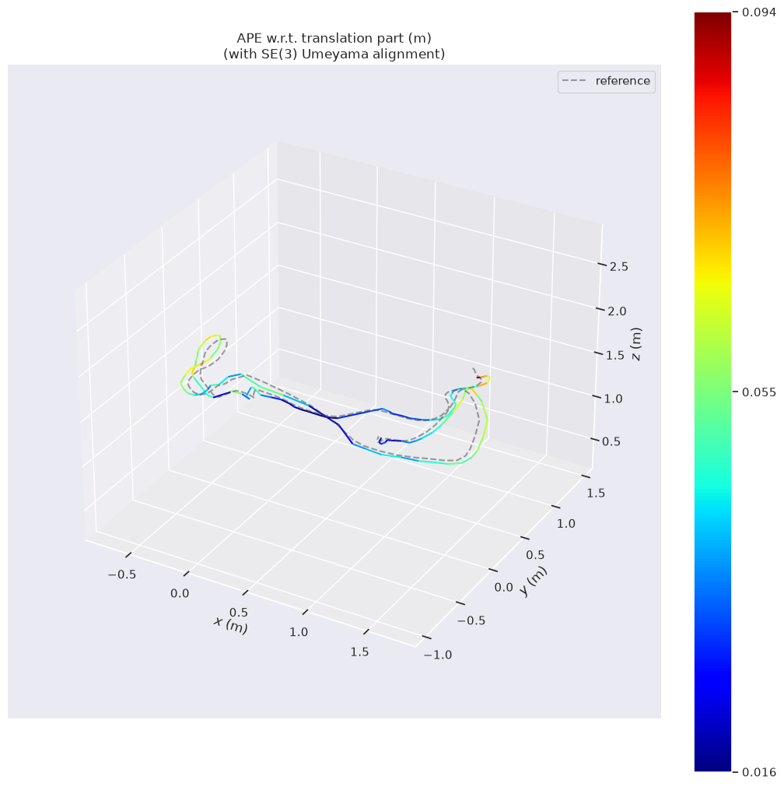
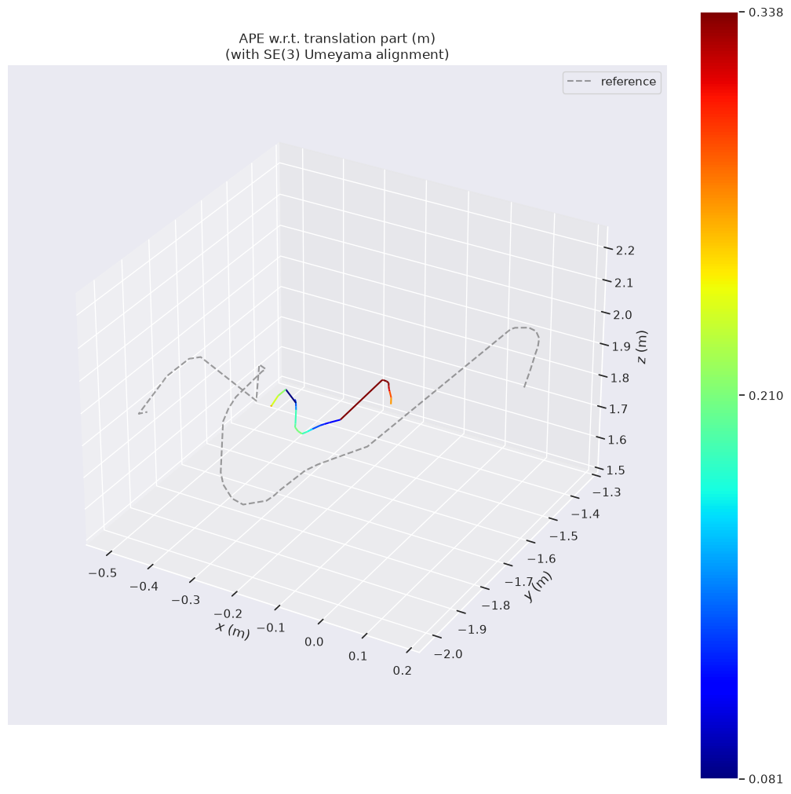
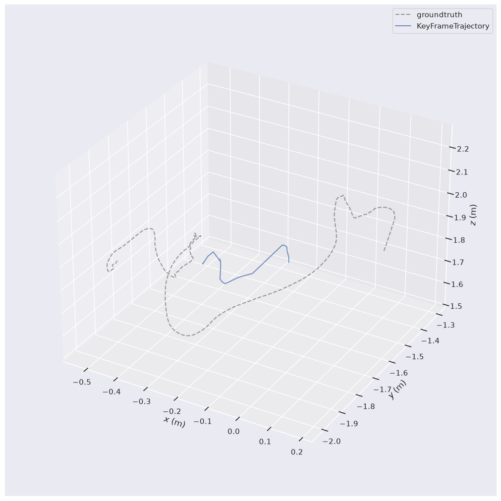

# Robust Visual SLAM for Mobile Robots in Dynamic Environments

A research-oriented robotics project investigating robust visual SLAM in dynamic environments using computer vision and AI-based perception.

## Project Overview

Visual SLAM enables a mobile robot to estimate its motion and build a representation of its surrounding environment using camera input.

However, dynamic objects such as people and moving vehicles can introduce unreliable visual features, potentially affecting camera tracking and trajectory estimation.

This project investigates methods for improving visual SLAM robustness in dynamic environments by combining visual features, motion information, semantic perception, and geometric consistency.

The initial implementation uses ORB-SLAM3 in monocular mode as the baseline. AI-based enhancements will be developed and evaluated incrementally.

## Project Objectives

- Establish a reproducible monocular visual SLAM baseline.
- Evaluate baseline performance in static and dynamic environments.
- Investigate semantic segmentation and optical flow for dynamic-scene understanding.
- Explore geometric consistency and feature reliability estimation.
- Integrate and evaluate AI-based improvements within the SLAM pipeline.
- Validate the approach using public datasets, simulation, and eventually a real camera/robot setup.

## Current Implementation

### Baseline System

- **SLAM Framework:** ORB-SLAM3
- **SLAM Mode:** Monocular
- **Feature Type:** ORB
- **Evaluation:** Absolute Trajectory Error (ATE)
- **Evaluation Toolkit:** evo                                                
- **Camera Configuration:** YAML files using OpenCV camera parameters

### Development Environment

- Ubuntu 24.04.4 LTS
- GCC 13.3
- CMake 3.28.3
- OpenCV 4.6.0
- Eigen 3.4.0
- ROS 2 Jazzy
- NVIDIA GeForce RTX 4050 Laptop GPU (6 GB)

## Datasets

### 1. TUM RGB-D — Freiburg1 Desk

A relatively static indoor sequence used for the initial baseline test.

Dataset source: [TUM RGB-D Dataset](https://cvg.cit.tum.de/data/datasets/rgbd-dataset)

### 2. Bonn RGB-D Dynamic — Balloon

A dynamic indoor sequence used to investigate baseline behavior in the presence of moving objects.

Dataset source: [Bonn RGB-D Dynamic Dataset](https://www.ipb.uni-bonn.de/data/rgbd-dynamic-dataset/)

The datasets are not included in this repository. Download them from their respective official sources.

## Baseline Evaluation Results

The following results were obtained using the ORB-SLAM3 monocular baseline.

| Dataset | Metric | Result |
|---|---|---:|
| TUM Freiburg1 Desk | ATE RMSE | 0.051107 m |
| Bonn Balloon | ATE RMSE | 0.225550 m |

ATE was calculated using evo with trajectory alignment and timestamp interpolation.

The Bonn result indicates a larger trajectory error than the TUM result. This observation alone does not establish that dynamic objects are the only cause; calibration, monocular scale, tracking behavior, and other factors may also contribute.

### TUM Freiburg1 Desk



### Bonn Balloon





Additional evaluation plots and trajectory files are available in the `results/` directory.
## Repository Structure

```text
.
├── configs/
│   ├── TUM1.yaml
│   └── BonnBalloon.yaml
├── docs/
├── results/
│   ├── baseline/
│   └── bonn_balloon/
├── scripts/
├── .gitignore
└── README.md
